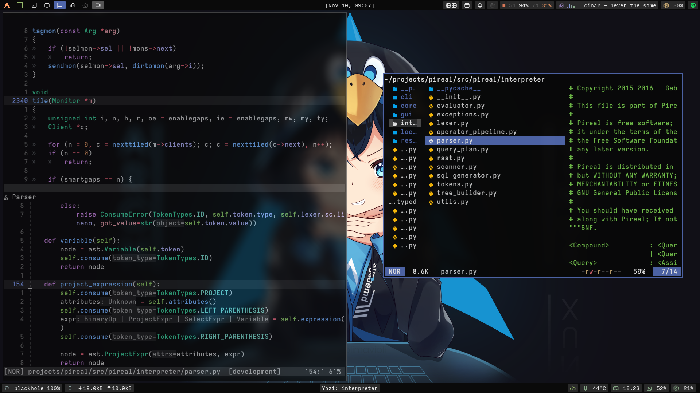

# dotfiles

- OS: [Arch Linux](https://archlinux.org/)
- WM: [Qtile](http://www.qtile.org/)
- Shell: [fish](https://fishshell.com/)
- Terminal: My [own](https://github.com/centaurialpha/st) build of [st](https://st.suckless.org/)
- Editor: [Neovim](https://neovim.io/)
- Browser: [Firefox](https://www.mozilla.org/firefox/)
- Launcher: My [own](https://github.com/centaurialpha/dmenu) build of [dmenu](https://tools.suckless.org/dmenu/)
- File Manager: [broot](https://github.com/Canop/broot)
- Compositor: [picom](https://github.com/yshui/picom)

## Screenshot


## How to install
Managed with [yadm](https://yadm.io/):
```
yadm clone git@github.com:centaurialpha/dotfiles.git
```

Hardware differences between machines (battery name, CPU sensor, NVIDIA,
backlight, monitors) are detected at runtime by the qtile config and
`monitor-setup`, so every machine uses the same files.

### Neovim plugin manager
```
sh -c 'curl -fLo "${XDG_DATA_HOME:-$HOME/.local/share}"/nvim/site/autoload/plug.vim --create-dirs \
       https://raw.githubusercontent.com/junegunn/vim-plug/master/plug.vim'
```

Inside nvim: `:PlugInstall`

### Other
- Install fisher
- Install pure prompt: `fisher install pure-fish/pure`
